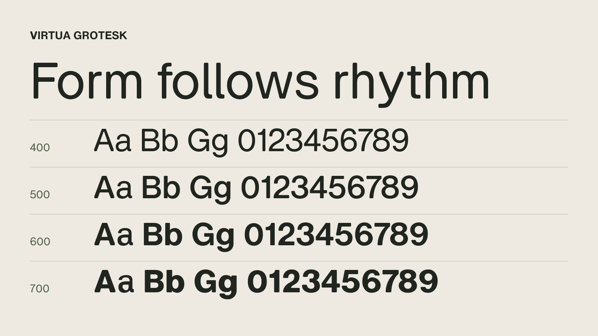

# Virtua Grotesk

Virtua Grotesk is a typeface designed by Eli Heuer for Latin, Arabic and
Hebrew. It is a grid-based neo-grotesk drawn on a dyadic self-labeling grid
system: nested grids built on powers of two. The grid records drawing intent
and limits the number of possible points. The variable font has a weight axis
from Thin (100) to Black (900) and an optical size axis from 14 to 144 pt.

The description of the design, with its idea, its precedents and its rules,
is in [CONTEXT.md](CONTEXT.md).



The font is in development and is intended for Google Fonts. Run `make status` to generate
the glyph grading report. The release scope, open decisions and links to
the Google Fonts guide are in
[documentation/google-fonts.md](documentation/google-fonts.md). The design
background is in the article
[Virtua Grotesk: Grid Systems for Dataset Engineering](https://elih.net/blog/virtua-grotesk).

## The idea

### A system, not a set of drawings

A typeface is many drawings that work as one system. To design the system
and not the single object is an old modernist aim. Karl Gerstner argued for
it in *Designing Programmes* (1964). In practice it had limits: strict rules
made type stiff, because a rule cannot make the optical corrections that the
eye needs.

Virtua Grotesk keeps the system and keeps the corrections. Its grid records
which point is a default of the system and which point is a correction by
the designer.

### The precedent: LL Replica

The nearest precedent is LL Replica by Norm (Dimitri Bruni and Manuel Krebs),
released by Lineto in 2008. Three of its decisions matter here.

- **A coarse grid.** FontLab gives 700 units to the cap height. Norm used
  70, a step of 10 units, and every point and handle had to be on a step.
  Norm did not accept that a finer grid gives more freedom: fewer options
  made each decision larger and the design more its own.
- **A visible grid.** The corners are cut one grid step wide, with the same
  bevel on inside and outside joints. The constraint made the look, and the
  look shows the constraint.
- **Cut diagonals.** The ends of diagonal strokes are cut, so A, K and R
  have no pointed apex and the letters can be set tight.

From a distance Replica looks like a familiar grotesque. The differences
show at large sizes. Virtua has the same two scales: at 16 pixels its
16-unit chamfer is a quarter of a pixel, and at display sizes it is the
character of the face.

### What Virtua changes

Virtua uses powers of two where Replica uses tens, and two grids where
Replica uses one.

- The em is 1024 units, which is 2 to the power 10.
- Structural points are on the 8-unit grid. This is the default.
- An optical correction by the designer is on the 2-unit grid. Every point
  is on this grid.
- Corners are cut with a 16-unit chamfer, and a tip ends on a flat, never
  on an acute point.

A second system labels measurements. Every measurement is a sum of powers
of two, and the number of terms describes it. A 64-unit stem is too light
and a 128-unit stem is too heavy, so the Regular stem is 96 = 64 + 32.
Where 96 is too light, the font uses 112 = 64 + 32 + 16. More terms often
mark an optical adjustment. They are not a fault.

Spacing follows the same rule. Sidebearings and kerning use the 8-unit grid
by default, which gives the text a small set of recurring intervals.

### Sources as data

Most fonts were not made as training data: their points are where the
designer put them, and each font has its own habits. In Virtua the two
systems turn the drawing conventions into data, without extra labels.

- **Consistency.** The same stroke logic, chamfer sizes and start points
  recur in the whole glyph set. A model or an agent learns one design.
- **Measurable output.** A script can check the grids and the stroke
  values. The checks do not decide quality, but they give a draft an
  objective first test.
- **Clean interpolation.** The Regular stem is 96 and the Bold stem is 192.
  The weight between them has a 144-unit stem, also on the grid.

For this reason AI agents draft glyphs from the approved drawings, and a
small language model, Virtua-12M, is trained on the sources. A draft is not
a finished glyph. Eli Heuer draws, corrects and approves every glyph.

### Scripts and weights

Latin, Arabic and Hebrew use the same grid, the same chamfer and the same
stroke logic. The upright variable font has weight masters at Thin (100), Regular (400),
Bold (700) and Black (900). Each weight has masters at 14 and 144 pt.
The 144 pt masters start with the drawing and spacing of the 14 pt masters.
An italic is planned.

### Sources

The main source of this chapter is the article
[Virtua Grotesk: Grid Systems for Dataset Engineering](https://elih.net/blog/virtua-grotesk).
The facts about Replica are from that article, from
[Fonts In Use](https://www.fontsinuse.com/typefaces/7436/ll-replica) and
from the Eye article
[Buying into the Norm cosmos](https://eyemagazine.com/feature/article/buying-into-the-norm-cosmos).

## Build

Install Python 3.13 or later, then run from the repository root:

```sh
make setup
make build
```

The build writes `fonts/variable/VirtuaGrotesk[opsz,wght].ttf` and nine static
fonts in `fonts/ttf/`. Git ignores `fonts/`. The editable sources are the two
UFO masters and the designspace in `sources/`.

## Work on the font

| Command | Use |
| --- | --- |
| `make runebender` | Open the sources in Runebender. Install it with `cargo install --locked --git https://github.com/fontgarden/runebender runebender`. |
| `.venv/bin/fgtools media --list` | List the formats, the canvases and the pages of the proof. `make proofs PAGE="spacing kerning"` and `make media FORMAT=videos` make a part only. |
| `make proofs` | Build the Print Proof and Full Proof in `output/proof/`. |
| `make twitter-animation` | Render each script in `documentation/media/twitter/animations/`. Use one file per animation, such as `weight-axis.rs`. Each writes `output/twitter/<name>.mp4` and `<name>-grid.mp4` for the proof index. |
| `make media-generic` | Render Font.Garden layouts with this font’s branding. |
| `make media-custom` | Render layouts defined by this project. |
| `make media` | Build, then render the marketing media (images, carousels and video for Instagram, LinkedIn and X) into `output/media/`. Needs DesignBot, and `ffmpeg` for video. |
| `make render GLYPHS="a n"` | Draw glyphs large for review, with the change since `main`. |
| `make test` | Build, then check the repository and check the fonts with Fontspector. |
| `make help` | All commands. |

The design rules, with the values that the tools check, are also in
`CONTEXT.md`. The rules for work on the sources are in
[AGENTS.md](AGENTS.md).

## Mark colors

Each glyph has a mark color in each master. The color tells people and agents
what they can do with the glyph. The full policies are in
[CONTEXT.md](CONTEXT.md).

| Color | Meaning |
| --- | --- |
| Green | Approved by Eli. A reference for other glyphs. Frozen. |
| Yellow | Close. Needs small edits. |
| Orange | Better, not good enough. Keep the useful construction. |
| Red | Broken. Can be replaced. |
| Purple | AI drawing that Eli has not reviewed. |
| Blue | Composite that needs diagnosis. |
| Pink | Composite that needs small edits. |

Use green glyphs as drawing references. Where no green glyph has the
construction, use a yellow donor as described in [CONTEXT.md](CONTEXT.md).
The release target is every glyph green in every master.

## Tools

The source tools are shared by all Font.Garden fonts and are in
[fgtools](https://github.com/fontgarden/fgtools), with the
command `fgtools`. `make setup` installs them. The fonts are built with
fontc and checked with Fontspector. The guide is at https://font.garden/docs.

AI tools help with code, documentation and draft glyphs. Eli draws, reviews
and approves the glyphs.

## License

The font is licensed under the [SIL Open Font License, Version 1.1](OFL.txt).
The copyright holders are in [AUTHORS.txt](AUTHORS.txt) and the contributors
in [CONTRIBUTORS.txt](CONTRIBUTORS.txt). Report problems in
[GitHub issues](https://github.com/eliheuer/virtua-grotesk/issues).
