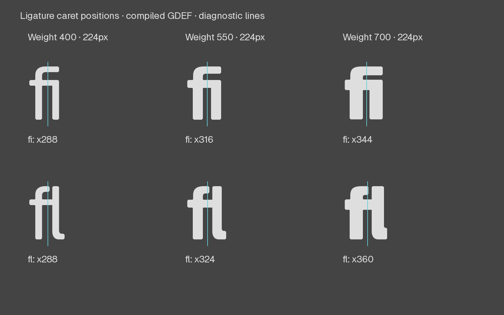

# LAT-001 batch24 · Ligature carets and current package QA

Baseline: `fb5a64be`. Local preparation only; no push or publication.

Fresh online, unexcluded Fontspector 1.9.0 package QA exposed missing fi/fl
caret positions. Added only `caret_1` anchors to fi/fl in both masters:
Regular288/288, Bold344/360, y0. Values are on8 and place the caret between
component stems. The anchors interpolate in the VF and are present in all four
static fonts. This checks metadata and a drawn diagnostic, not native editor
cursor behavior.

Four GLIFs only; all1791 other source files unchanged. Full dependency closure,
326 Arabic reservations/master and green131/74 source hashes preserved. Existing
anchors, contours, advances, grades and component geometry remain exact. VF table
differences are only GDEF and head; all ink, metrics and shaping tables unchanged.
Active rebuilt fonts match scratch tables except head timestamps.

## Verification and actual images

- 74 scoped checks;17 Latin regression methods pass on scratch and active builds.
- Frozen engineering baseline reproduces216 Hebrew failing subcases, zero new or
  resolved failures; this is not a whole-suite pass.
- Full forms/words at400/550/700 and enlarged224px glyph/caret diagnostic inspected.
  Before/after glyph pixels are identical. Whole silhouettes retain open fl heads;
  dense Bold, compact heads and new pair rhythm remain human optical-review items.
- Actual Diffenator same-text supplement inspected in Virtua and Rubik at all
  three weights; screenshots and font hashes in `diffenator/review.json`.
  Stock reports generated; no exhaustive language review claimed.
- Active build and preflight completed. No curve changes; existing curve evidence
  remains in batch22. No automated or human grade promotion.

## Current package result

| Online unexcluded package | FAIL | WARN | PASS | INFO | SKIP |
| --- | ---: | ---: | ---: | ---: | ---: |
| Before caret repair | 10 | 11 | 158 | 10 | 40 |
| After caret repair | 10 | 10 | 159 | 10 | 40 |

`ligature_carets` now passes. Full report, input hashes, command and tool version
are retained in `qa-before/` and `qa-after/`; `qa-summary.json` retains every
remaining warning/failure message. Counts are subresults, not unique checks.
Package font is the active rebuilt VF; preview metadata/license/article were
held constant. Provisional date, primary-script/source-delivery choices and
artwork remain unapproved. No licensing attestation was made.

The ten tofu failures concern U+0302, U+0331 and U+1EBC/U+1EBD being absent from
Google Fonts serving sets declared in this package, despite existing cmap ink.
Installed gfsubsets mappings are recorded in `serving-subset-diagnosis.json`.
Adding unrelated script declarations or Vietnamese solely to hide failures is
not a repair. These need a serving-policy/coverage decision; no upstream issue
was sent. Batch23's ogonek normalization repair remains fixed and distinct.

Remaining warnings include breve-family contour direction, outline alignment,
overlapping segments (iogonek plus reserved Arabic), reserved Arabic Meem
interpolation, contour-count heuristics, Finnish auxiliary coverage, two subset
coverage recommendations, unreachable encodings and designer profile. Preserve
Arabic and green sources; do not alter drawings merely to satisfy heuristics.

Next bounded repair: inspect breve donor winding and full reverse consumers,
then repair compatible contour direction without moving geometry if authorized
closure permits. Then four missing combining marks, independent symbols and
remaining release work. Full Rubik language coverage, native-reader review,
platform text behavior and release approval remain outstanding.
