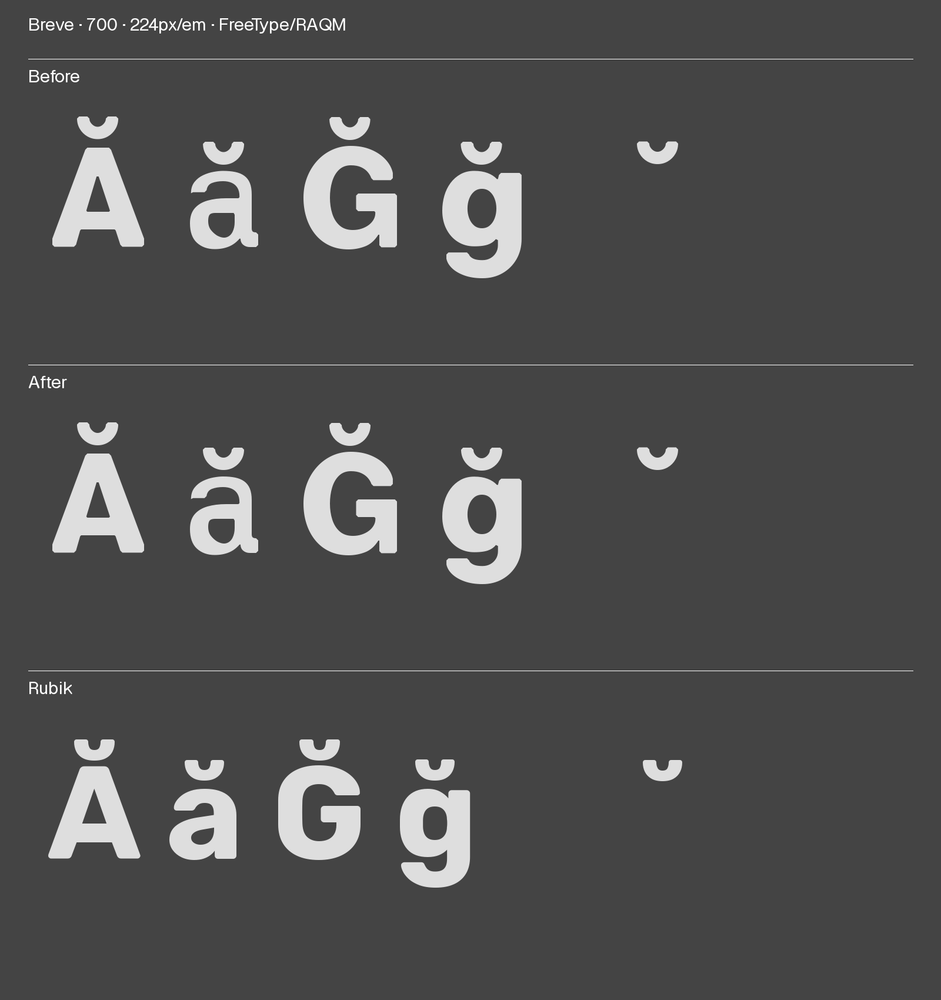

# LAT-001 batch25 · Breve contour direction

Baseline `a2f6fe18`. Reverses only the single18-point contour in Regular and
Bold **breve**. This fixes the counterclockwise outer contours emitted in the
compiled breve and its component users. No point coordinates, cubic shape,
anchors, widths, colors or component placements change. Both donors remain
purple; all human grades are preserved. No push or release approval.

The full reverse closure is14 glyphs/master. No green or Arabic consumers:
326 Arabic reserved sources/master and131/74 green sources retain exact hashes.
All1793 other source files unchanged. Both sources retain compatible point-type
patterns. Reversing the candidate a second time reconstructs the original point
records exactly. Signed source areas change sign with unchanged magnitude
(Regular23859.2, Bold36486.4); floating-point accumulation tolerance1e-8.

## Verification and visual review

- 78 scoped checks: source guards, compatible patterns, shaping comparisons at
  five VF weights and all four statics. GPOS/GSUB/GDEF/cmap/metrics tables exact.
- VF table changes only head/glyf/gvar; only compiled breve's glyf record differs.
  4,410 exact compiled glyph-geometry comparisons (all882 glyphs at five weights)
  agree after normalizing segment direction and decomposing components. This
  checks quadratic/cubic controls, not just sampled curve positions or bounds.
-17 Latin regression methods pass on scratch and active builds. Frozen Hebrew
  baseline remains216 failing subcases, zero new/resolved; not a whole-suite pass.
- Complete forms/words at400/550/700,224px endpoint details, actual Diffenator
  target supplement and first stock mixed-text viewport compared against Rubik
  at all three weights. The open bowl and clipped ends retain their shape;
  dense Bold bases, breve proportions and uneven long-text spacing remain for
  optical review. No exhaustive language approval.
-75 FreeType/RAQM raster comparisons at32/48/224px and five weights show pixel
  differences despite exact compiled geometry; `raster-identity.json` retains
  bounding boxes, changed pixel counts and alpha deltas. **Pixels are not
  identical.** An enlarged overlay is retained. No source shape was adjusted
  to hide the differences. An initial detail layout overlapped its standalone
  marks with letters; the final detail places standalone marks beside letters.
- Curve lint retains two G2 extrema and four intentional45-degree terminal
  corners/master; no crest/tension/kink flags. Reversal changes signed curvature
  orientation, not curvature magnitude or the inherited terminal construction.
- Active build/preflight complete; all active/scratch font tables match except
  head timestamps. Final source, protected-source and font hashes retained.

## Fresh package QA

Full online, unexcluded Fontspector1.9.0 package result:

| State | FAIL | WARN | PASS | INFO | SKIP |
| --- | ---: | ---: | ---: | ---: | ---: |
| Batch24 baseline |10|10|159|10|40|
| Batch25 winding repair |10|9|160|10|40|

`outline_direction` passes. The first focused invocation selected zero checks
under the default profile; it was not accepted as verification. The corrected
Google Fonts-profile invocation executed one check and passed. Full package QA
then independently confirms the result. The first package attempt encountered
sandbox network errors; retained in `qa-network-restricted/`, followed by the
completed online run in `qa-online/` with its command, version and input hashes.
Package uses the scratch VF; active built tables match except head timestamps.

The ten existing serving-set tofu failures remain, as do nine warning
subresults covering outline alignment, iogonek/reserved-Arabic duplicate
segments, reserved Arabic interpolation, contour heuristics, Finnish auxiliary
coverage, two subset recommendations, unreachable encodings and designer profile.
Metadata/license/article were copied unchanged from the prior local package;
provisional choices/artwork remain unapproved. No false subset declarations,
exclusions, licensing attestations or external publication.

Next: four missing combining marks U+0312/U+0335/U+0337/U+0338, then independent
common symbols and technical release blockers. Preserve the current protected
base spacing/attachment findings and Arabic manual-editing reservation.
